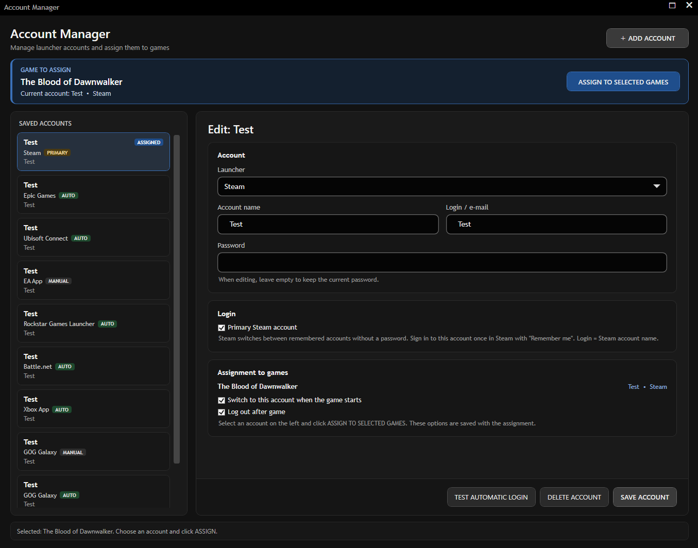
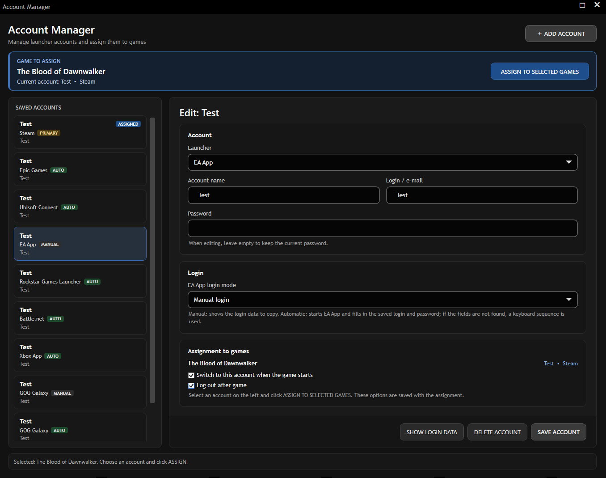
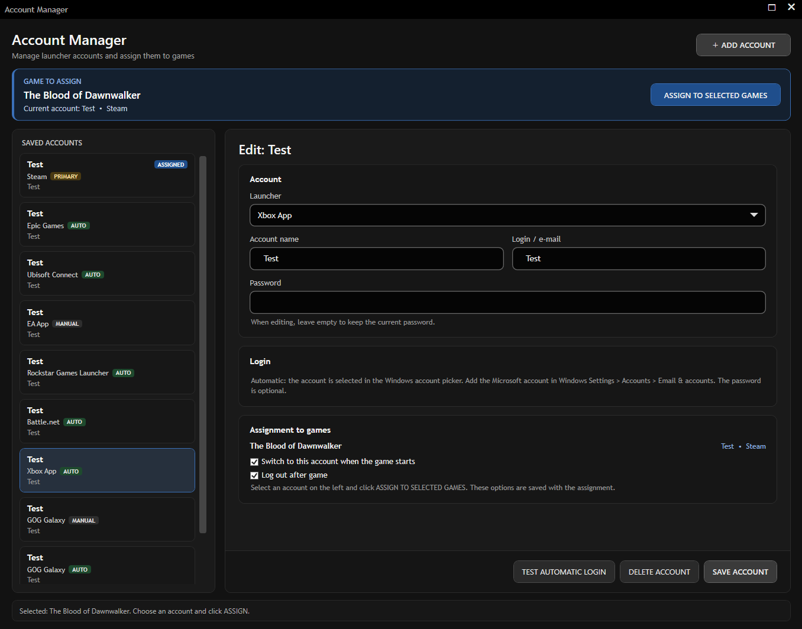
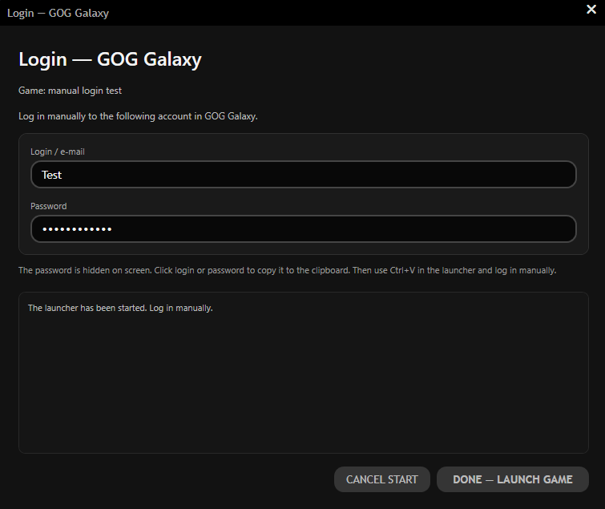

# Playnite Account Manager

A [Playnite](https://playnite.link) extension that keeps several accounts per game launcher and signs the right one in before a game starts. Each game is assigned an account; starting the game switches the launcher to it — automatically where the launcher allows it, otherwise with a controller-friendly manual login window.

**Version 0.10.0** · Windows · Playnite SDK 6 · GPL-3.0

[](https://ko-fi.com/zorinel)

## Screenshots



| EA App account (login mode) | Xbox App account | Manual login window |
|---|---|---|
|  |  |  |

## Supported launchers

| Launcher | Login modes | How the account is switched | Password needed | If it fails |
|---|---|---|---|---|
| **Steam** | automatic | Selects a remembered account (`loginusers.vdf`) and restarts Steam | no | notification |
| **Epic Games** | automatic / manual | Restores the account's saved, encrypted "Remember me" session (~5 s, no typing) | yes (first login) | types the credentials (TAB sequence) |
| **EA App** | automatic / manual | Fills e-mail and password on the login page through its accessibility tree (MSAA), ~8 s | yes | keyboard (TAB) sequence |
| **Ubisoft Connect** | automatic / manual | Fills the login page through MSAA | yes | keyboard sequence |
| **GOG Galaxy** | automatic / manual | Clears the session, restarts Galaxy and types into its sign-in window | yes | manual window |
| **Battle.net** | automatic / manual | Clears the session, restarts Battle.net and fills its sign-in window through MSAA | yes | manual window |
| **Rockstar Games Launcher** | automatic | Closes the launcher, clears the session, fills the sign-in window through MSAA and clicks *Sign in* | yes | manual window |
| **Xbox App** | automatic | Signs out and picks the account in the Windows account picker (~8 s, instant if already active) | no | manual window |
| **Other** | — | Only stores the account; nothing is switched when the game starts | optional | — |

*Manual* shows the login and a masked password in a window; clicking a field copies it for Ctrl+V in the launcher. New EA App, Epic Games, GOG Galaxy and Battle.net accounts start in manual mode — switch them to *Automatic* in the account's **Login** section.

## Installation

1. Download `PlayniteAccountManager_0.10.0.pext` from the latest [release](../../releases/latest) (or build it, see below).
2. Drag the file onto Playnite (or install it from *Add-ons*) and restart Playnite.
3. Open **Account Manager** (*Menadżer Kont*) from the Playnite main menu or from a game's context menu.

## Quick start

1. **Add an account** — name, launcher, login/e-mail and password. Choose *Automatic* or *Manual* for EA App, Ubisoft Connect, Epic Games, GOG Galaxy and Battle.net.
2. **Assign it** — select games in Playnite and open Account Manager: the selected games and their current account are shown at the top. Choose an account and click *Assign to selected games* next to them. Each assignment has:
   - **Switch to this account when the game starts** — keep it on for Steam and for Ubisoft Connect in automatic mode;
   - **Log out after game** — see [After the game](#after-the-game).

   In **Fullscreen mode** use the gamepad: open the game's *···* menu → *Extensions* → *Account Manager* → *Assign account* and pick a saved account (accounts of the game's launcher are listed first, the current one has ✓). *Remove assignment* is in the same menu. Accounts are added and edited in Desktop mode.
3. **Test** — the *Test* button runs the automatic login or shows the manual window.
4. **Start the game** — the assigned account is signed in first. Games without an assignment are left alone (except Steam, see below).

### Launcher-specific setup

| Launcher | What you need |
|---|---|
| Steam | Sign in to every Steam account once in Steam with "Remember me". Login = Steam account name. Mark one account as **Primary**: Steam games without an assignment use it (the first Steam account if none is marked). |
| Epic Games | Keep "Remember me" enabled in Epic. The first automatic login of an account types the credentials; later switches restore the saved session. |
| Xbox App | Add each Microsoft account to Windows: *Settings → Accounts → Email & accounts → Add a Microsoft account* ("Microsoft apps only"). Login = the account e-mail; the password is optional. |
| EA App, Ubisoft Connect, Rockstar, GOG Galaxy, Battle.net | Login and password. Additional verification (2FA, CAPTCHA) stops the automation and asks you to finish in the launcher. |

## How it works

- **EA App / Ubisoft Connect** — both login pages are Chromium pages. The plugin reads them through MSAA, finds the e-mail and password fields by role (not by caption or TAB order, so the launcher language does not matter), types into them, presses the button below and confirms that the login form is gone. Hidden off-screen inputs are ignored. If the fields are not exposed, the previous keyboard sequence is used.
- **Rockstar Games Launcher** — all launcher processes are closed, the local session is cleared and the launcher restarts; the separate sign-in window (also a Chromium page) is filled the same way and *Sign in* is pressed with a real mouse click (the page rejects the accessibility click, a second click follows if needed); success is the window closing. Its page answers accessibility queries slowly, so finding the form takes ~15 s on top of the launcher start. Any failure shows the manual login window.
- **Battle.net** — after the local session is cleared and Battle.net restarts, its sign-in window (Chromium) is filled through MSAA: a remembered account is left with *Switch account*, then e-mail → *Continue* and password → *Log in*. Fields are clicked before typing and the form is re-read after each step, because the page animates between steps. Success is the sign-in window closing; any failure shows the manual window.
- **GOG Galaxy** — the sign-in page runs in QtWebEngine, which exposes no accessibility tree. After clearing the session and restarting Galaxy, the plugin waits until `GalaxyClient.log` reports the loaded login page, clicks the e-mail and password fields at fixed positions of the fixed-size sign-in window, types the credentials and presses Enter. Success is the sign-in window closing or the log reporting the login redirect; otherwise the manual window is shown.
- **Epic Games** — the launcher draws its UI in Unreal Engine and exposes no accessibility tree, so accounts are switched with sessions instead: before switching, the current account's session is saved; the assigned account's session is restored and the launcher log confirms that the expected Epic account signed in. The rotated token is saved again right after login.
- **Xbox App** — profile menu → *Sign out* → *Sign in* → the account tile with the assigned e-mail in the Windows picker → *Continue* → Gaming Services confirmation (checked against the e-mail). Nothing happens if the remembered gamertag is already signed in.
- **Manual window** — shows the login and a masked password; clicking a field copies it to the clipboard for Ctrl+V in the launcher. Used for manual-mode accounts and as the Battle.net, GOG Galaxy, Rockstar and Xbox fallback.

Keyboard input is only sent while the launcher window has focus and stops immediately if focus moves to another application.

### After the game

When the game stops with **Log out after game** enabled, or whenever Playnite cancels the game start:

| Launcher | Action |
|---|---|
| Steam | Restores the Steam account that was active before |
| Epic Games | Saves the session for the next switch, then clears it |
| EA App, Ubisoft, GOG, Battle.net, Rockstar | Closes the launcher and clears the local session (installed games are never touched) |
| Xbox App | Stays signed in; the next game switches only if a different account is assigned |

## Security

- Passwords and Epic sessions are encrypted with **Windows DPAPI** (current Windows user + plugin-specific entropy). Their files in the plugin data folder are readable only by your Windows account and SYSTEM.
- Copied credentials are excluded from clipboard history (Win+V) and cloud clipboard and are cleared after 60 s or when the manual window closes.
- Passwords, tokens and field values are never logged; account names are masked in the Playnite log.
- DPAPI protects against other Windows users and copied files, not against malware running under your own account.

Plugin data (*Playnite → ExtensionsData → 2a6de1ef-…*):

| File | Content |
|---|---|
| `credentials.dat` | encrypted passwords |
| `epic-sessions\` | encrypted Epic sessions (delete to forget them) |
| `xbox-gamertags.txt` | gamertag per account (not secret) |

See [SECURITY.md](SECURITY.md) for reporting issues.

## Troubleshooting

| Problem | Check |
|---|---|
| Launcher not found | The plugin searches Program Files, registry, running processes and Start Menu shortcuts — make sure the launcher starts normally. |
| Automatic login stops | Look for lines starting with `EA MSAA`, `Ubisoft MSAA`, `Rockstar MSAA`, `Battle.net MSAA`, `GOG INPUT`, `Epic Games` or `Xbox` in the Playnite log (`%AppData%\Playnite\extensions.log`). |
| Epic always types the password | "Remember me" is disabled in Epic, or the saved session expired — the next successful login saves a new one. |
| Xbox shows the manual window | The account e-mail is not added in Windows *Email & accounts*, or it differs from the login in Account Manager. |
| Game Pass game reports a licence error | The Microsoft Store is signed in with a different account than the Xbox app ("Account mismatch" banner in the Xbox app). |

## Building

Requirements: Windows, Visual Studio 2022+ (MSBuild), .NET Framework 4.6.2 targeting pack.

```powershell
./build.ps1      # Release build
./package.ps1    # creates PlayniteAccountManager_0.10.0.pext
```

Every push to `main` runs a secret scan, the Release build and packaging in GitHub Actions and uploads the `.pext` as an artifact.

```text
src/PlayniteAccountManager/
├── Models/        accounts, assignments, launcher types
├── Services/      one adapter per launcher, ChromiumLoginAutomation (MSAA),
│                  EpicSessionVault, XboxAppUiAutomation, SecureCredentialStore
├── Views/         Account Manager and manual login window
└── Localization/  44 Playnite languages (en_US base; full UI in all, errors in en/pl)
```

Tested on Windows 11 (i5-12400, RTX 5060 Ti, 2560×1440) with Steam, EA App 13.809, Ubisoft Connect 170, Epic Games Launcher 20.3, GOG Galaxy 2.1, Battle.net and Xbox App 2610.

## ☕ Support

PlayniteAccountManager is free. If it makes your Playnite setup better and you'd like to support further development, you can buy me a coffee on Ko-fi:

[](https://ko-fi.com/zorinel)

https://ko-fi.com/zorinel


## History and license

Release notes: [CHANGELOG.md](CHANGELOG.md). Author: **zorinel**. Licensed under [GPL-3.0](LICENSE).
